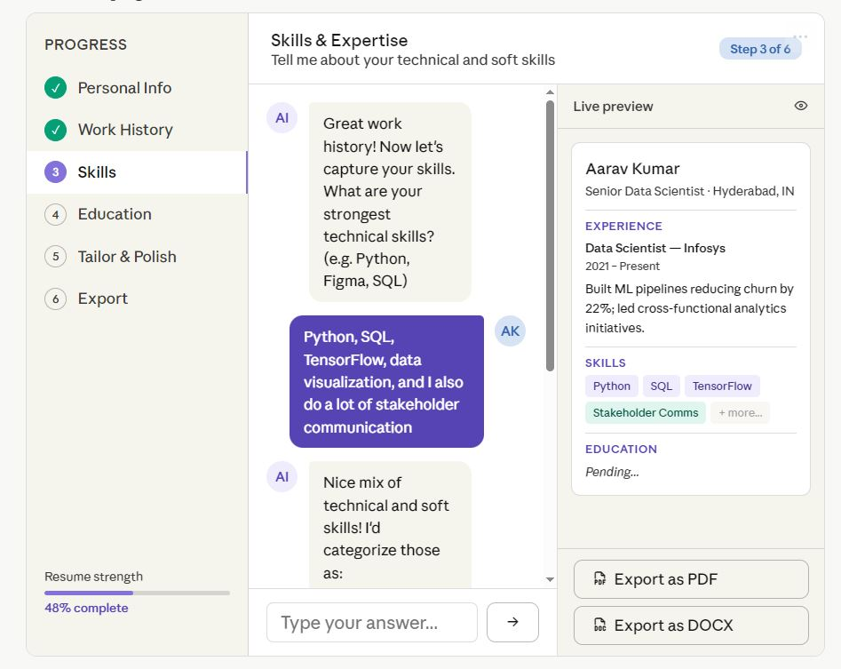

# Agentic Resume Builder

An AI-assisted resume builder that interviews you section by section and turns rough answers into polished, impact-driven resume content. Each resume section is driven by its own **LangGraph** agent with human-in-the-loop checkpoints: the agent asks targeted questions, drafts content, and lets you review and refine it before it is saved.

Everything runs locally: a **local LLM via Ollama**, **MongoDB** for storage and agent checkpoints, a **FastAPI** backend, and a **React + Ant Design** frontend.



## How it works

1. **Structured sections** (Personal Info, Education, Certifications) are captured through plain forms and stored directly.
2. **Narrative sections** are generated by agents that follow the same general loop:

   ```
   Prepare questions → Collect answers (interrupt) → Draft
        → Present for review (interrupt) → Refine? ─yes→ Ask for changes → Redraft ─┐
                                                   └no→ Store in DB              ◄──┘
   ```

   The graph pauses at each interrupt, the API returns the questions or draft to the UI, and the user's response resumes the graph from its MongoDB checkpoint.

| Agent | File | Purpose |
|---|---|---|
| Professional Summary (PSG) | `agent_psg.py` | Generates and refines the professional summary |
| Work History (WH) | `agent_wh.py` | Iterates over each job/project, asks follow-ups, drafts bullets, then builds an overall work-history section |
| Personal Projects (PP) | `agent_pp.py` | Same per-project flow for personal projects |
| Final Draft (FD) | `agent_final.py` | Pulls all saved sections together into a consolidated resume and refines it |

Prompts for each agent live under `prompts/<AGENT>/`. The overall flow is sketched in `Ideation/CoreFlow.drawio`.

## Tech stack

- **Backend:** Python 3.11+, FastAPI, Uvicorn, LangChain, LangGraph, Pydantic
- **LLM:** Ollama (`nemotron-3-nano:4b` by default, configured in `dependencies.py`)
- **Storage:** MongoDB (resume data + LangGraph checkpoints via `langgraph-checkpoint-mongodb`)
- **Frontend:** React 19, TypeScript, Vite, Ant Design, Axios

## Project layout

```
app.py              FastAPI app and all HTTP endpoints
agent_*.py          LangGraph agents (one per resume section)
dependencies.py     LLM, MongoDB client and checkpointer setup
model.py            Pydantic models for resume sections and API payloads
userrepo.py         MongoDB read/write helpers for resume sections
responsebuilder.py  Maps agent interrupt payloads to API responses
prompts/            System prompts per agent (PSG, WH, PP, FD)
ui/                 React frontend
postman/            Postman collection for exercising the agent flows
Ideation/           Flow diagrams
DetailedRequirement.md, checklist.md   Product vision and task breakdown
```

## Getting started

### Prerequisites

- Python 3.11+ and [Poetry](https://python-poetry.org/)
- Node.js (for the UI)
- [Ollama](https://ollama.com/) running on `localhost:11434` with the model pulled:
  ```
  ollama pull nemotron-3-nano:4b
  ```
- MongoDB running on `localhost:27017`

### Backend

```
poetry install
poetry run python -m uvicorn app:app --reload
```

The API runs at `http://localhost:8000` (`GET /health` should return `Ok`).

### Frontend

```
cd ui
npm install
npm run dev
```

The UI runs at `http://localhost:5173` and talks to the backend at `http://localhost:8000` (see `ui/src/api/BaseAPI.ts`).

## API overview

| Endpoint | Description |
|---|---|
| `GET /health` | Health check |
| `GET /pages` | Sections/pages available to the UI |
| `POST/GET /personal-info` | Save (starts a resume session) / fetch personal info |
| `POST/GET /education-info` | Save / fetch education |
| `POST/GET /certification-info` | Save / fetch certifications |
| `POST /{psg,wh,pp,fd}/start` | Start an agent run; returns a `thread_id` and the first questions or draft |
| `POST /{psg,wh,pp,fd}/resume` | Resume an agent run with the user's answers or refinement feedback |
| `GET /{psg,wh,pp,fd}/view` | PNG rendering of the agent's graph |

Resumes are keyed by the user's email; agent conversations are keyed by `thread_id`.

## Status and roadmap

This is a work in progress. The core resume-building agents are in place; planned features (see `DetailedRequirement.md`) include:

- Skills section agent and LaTeX-template PDF export
- Job post ingestion and job-fit / skill-gap analysis
- Tailored resumes and cover letters derived from a single base resume
- Skill assessment and learning roadmaps

## License

See [LICENSE](LICENSE).
